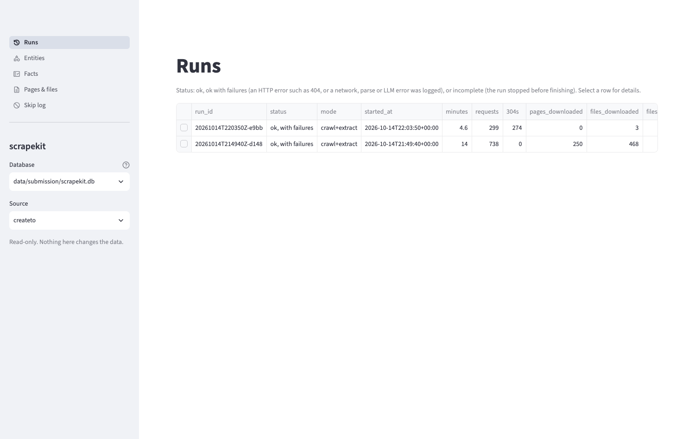
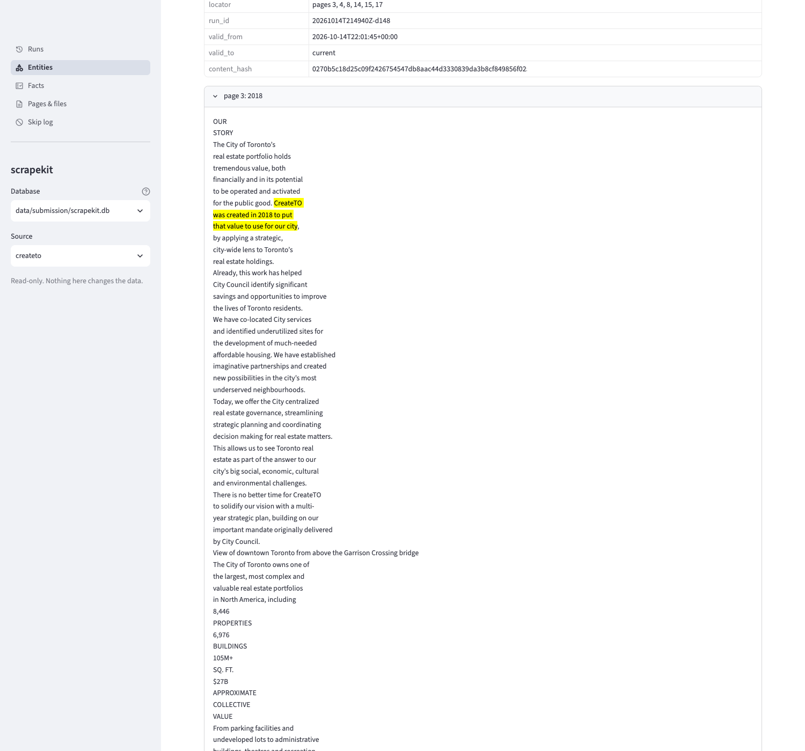
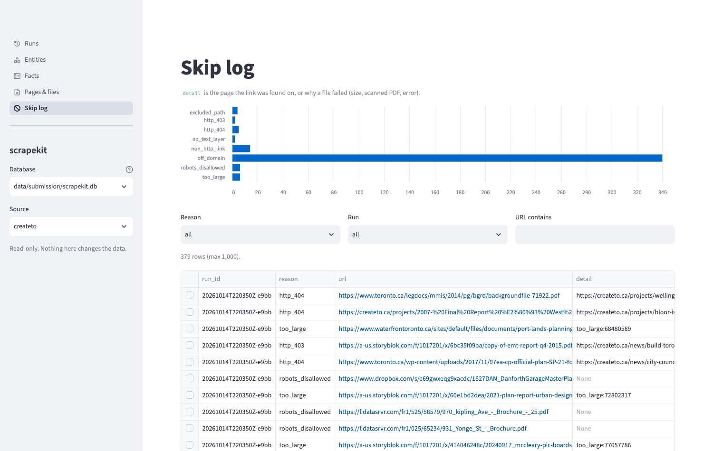

# scrapekit

A small, polite crawler that turns public websites and the files they link to into versioned, sourced data.

The first source is [CreateTO](https://createto.ca). Each website is described by one small `Source` config, so adding another site does not change the crawler.

- Crawls every public page on a site (sitemap + link walk).
- Downloads every linked file (PDF, Word, Excel), including files hosted on other sites. PDFs are parsed (text by page, plus LLM facts with citations); Word and Excel files are saved but not parsed yet.
- Saves a raw copy of every page and file, with one snapshot per version, so changes over time are kept.
- Logs every skipped or failed link with a reason.
- Writes a metrics report for every run (time, requests, files, records, paid calls, cost).
- Repeat runs use conditional requests and skip files whose URL never changes, so unchanged content is not downloaded or processed again.
- Everything site-specific lives in one config file per website; a test keeps site names out of the rest of the code.
- A read-only data browser (`scrapekit ui`) lets a downstream engineer navigate runs, entities, facts, pages and files, and skips, down to the raw file and the quoted PDF page.

How it works: see [docs/DESIGN.md](docs/DESIGN.md).

## Results (live runs on createto.ca, 2026-10-14)

Two runs into a fresh database: a first run, then an unchanged repeat 14 minutes later. Full reports: [run 1](examples/runs/run1-first.md), [run 2](examples/runs/run2-unchanged-repeat.md).

| | Run 1: first run | Run 2: unchanged repeat |
|---|---|---|
| Time | 14.0 min | 4.6 min |
| HTTP requests | 738 | 299 (274 answered `304 Not Modified`) [1] |
| Downloaded | 990 MB | 49 MB |
| Pages processed | 250 | 250 checked, 0 changed |
| Files processed | 468 (466 PDFs with text, 2 scanned) | 467 unchanged (440 not re-checked: immutable URLs), 1 now 404 |
| Documents extracted | 718 | 0 (all unchanged, skipped) |
| Useful records | 712 entities (74 projects, 136 news items, 468 documents, 34 pages) with 8,139 facts | no changes, 0 new facts |
| Facts by method | 5,385 rule-based (exact, free) + 2,754 LLM fields holding 3,221 cited facts | none |
| LLM facts dropped by the excerpt check | 65 of 3,286 (2%) | none |
| Paid LLM calls | 466 | 0 (466 cache hits) |
| LLM tokens in / out | 1,359,277 / 268,545 | 0 / 0 |
| LLM cost | $0.7426 (actual, reported by OpenRouter) | $0.00 |
| Skipped or failed links | 190, each with a reason: 170 off-domain, 7 mailto/tel, 3 over 50 MB, 3 blocked by robots.txt, 2 excluded paths, 2 dead links, 2 scanned PDFs, 1 forbidden (403) | same, plus 1 toronto.ca PDF that returned 404 in run 2 and was still 404 when re-checked (logged, last good facts kept) |

[1] These runs had a since-fixed bug: parallel workers could each fetch the same host's `robots.txt` (up to 4 times instead of once). Across the 8 hosts contacted, that is at most 24 extra requests per run (about 3% of run 1, 8% of run 2). Fixed with a per-host lock; an unchanged 10-page run went from 18 to 15 requests. All other numbers are unaffected.

**Costs** (labeled):

| Item | Cost | Type |
|---|---|---|
| LLM, first run (`google/gemini-3.1-flash-lite` via OpenRouter) | $0.7426 | Actual, from OpenRouter usage data |
| LLM, unchanged repeat | $0.00 | Actual (all answers cached by content hash) |
| LLM, development (trials and variant runs) | about $0.06 | Actual, summed from run reports |
| Hosting | $0.00 | Ran locally on a laptop |
| Hosting if deployed (small VM running the job daily) | about $5 to $10 per month | Estimate |
| Storage (893 MB raw copies + 19 MB SQLite) | about $0.02 per month on S3-class storage | Estimate |
| Other services | none | |

A daily schedule would cost about $0 per day in LLM fees when nothing changes, plus a fraction of a cent per changed PDF.

**Variants** (unchanged run, changed source, failed file), replayed from saved copies: [examples/variants/REPORT.md](examples/variants/REPORT.md).

**Example output:** [examples/export-sample/](examples/export-sample/) (a few projects, news items, documents and pages from the real export, plus `SCHEMA.md`).

## How this meets the brief

| Brief | Where |
|---|---|
| Start at the homepage, scrape pages as exhaustively as possible | Sitemap + link walk from `https://createto.ca/` ([DESIGN 5](docs/DESIGN.md)); 250 pages, 18 more than the sitemap lists |
| Find linked files, including on other hosts | Links in HTML and inside embedded JSON; 468 files from 5 hosts |
| Persist the scraped pages | Raw copy of every page and file, one snapshot per version (`data/raw/`, `snapshots` table) |
| Useful data points (location, phase, dates, ...) | Projects: phase, timeline, ward, address, intersection, lat/lon, site area, uses. News: dates, topics, related projects. PDFs: type, date, organization, summary, cited facts ([DESIGN 6](docs/DESIGN.md)) |
| Keep the source; page number or excerpt for file facts | Every fact has `source_url` and a `locator`; LLM facts carry page + verified excerpt |
| History: extraction time, corrections, amendments | `facts` never overwrite: `valid_from`, `valid_to`, `superseded_by`; every snapshot kept |
| Format another service can use | JSONL export with `SCHEMA.md` (`scrapekit export`) |
| Re-running as the site changes | ETags / 304, content hashes, extraction skipped for unchanged content, LLM cache |
| Public pages and files only; files may be on another host | robots.txt per host; files fetched cross-host, pages only on createto.ca |
| Log blocked or skipped links; do not DDoS | `skips` table with reasons; 1 request per second per host, retries with backoff |
| Two runs with time, requests, files, records, paid calls, cost | Results table above |
| Unchanged run, changed source, failed file | [examples/variants/REPORT.md](examples/variants/REPORT.md) |
| Label estimated costs | Costs table above |

## Setup

Requires Python 3.11+ and [uv](https://docs.astral.sh/uv/).

```bash
uv sync
cp .env.example .env   # add OPENROUTER_API_KEY (only needed for PDF extraction)
```

## Run

```bash
uv run scrapekit sources                     # list known sources
uv run scrapekit run createto                # crawl + extract (the normal command)
uv run scrapekit run createto --max-pages 20 # quick smoke test
uv run scrapekit crawl createto              # only download
uv run scrapekit run createto --revalidate-all  # also re-check files with immutable URLs (do this periodically)
uv run scrapekit extract createto            # only re-extract from saved copies, no network
```

LLM pass on PDFs (needs `OPENROUTER_API_KEY` in `.env`, never committed):

```bash
uv run scrapekit extract createto --llm-dry-run      # how many PDFs and estimated cost, no calls
uv run scrapekit extract createto --llm-limit 10     # try on 10 PDFs (about $0.02)
uv run scrapekit run createto --llm-budget 1.50      # full run, hard spend cap per run (default $0.50)
uv run scrapekit run createto --no-llm               # skip the LLM entirely
```

Each run prints a summary and writes:

| Output | What it is |
|---|---|
| `data/scrapekit.db` | SQLite: documents, snapshots, facts (with history), extractions, llm_cache, pdf_pages, skips, links, runs |
| `data/raw/` | Raw copies of pages and files, named by SHA-256 |
| `runs/<run_id>.md` / `.json` | Metrics for that run |

## Export for other services

```bash
uv run scrapekit export createto     # writes export/createto/*.jsonl and SCHEMA.md
```

`entities.jsonl` has one line per project, news item, document or page with current values and where each came from, plus `best_date` and a `within_last_5_years` flag. `facts.jsonl` has the full history. See `export/createto/SCHEMA.md`.

## Variant runs (unchanged, changed source, failed file)

```bash
uv run scrapekit variants createto --reuse-fixtures            # from the committed fixtures, no crawl needed
uv run scrapekit variants createto --reuse-fixtures --no-llm   # same, no LLM cost
uv run scrapekit variants createto                             # rebuild fixtures from your own crawl
```

Results: [examples/variants/REPORT.md](examples/variants/REPORT.md).

## Data browser (UI)

A local, read-only app for engineers who consume the data: see what was scraped and parsed, follow any value back to its source, and check how each run went.

```bash
uv sync --extra ui                                # Streamlit, only needed for the UI
uv run scrapekit ui --data-dir data/submission    # opens http://localhost:8501
```

| Page | What you can do |
|---|---|
| Runs | Every run with status (ok, ok with failures, incomplete), time, requests, 304s, downloads, facts, skips and LLM cost. Select a run for its skips and the facts it added, changed or removed. |
| Entities | Projects, news items, documents and pages, filtered by type or searched by any value. Select one for all its facts; select a fact for its provenance; toggle history to see replaced values. |
| Facts | Every value, filtered by entity type, field, method (rules or LLM), run, current or all. |
| Pages & files | Every URL with host, status, saved versions, the raw copy (PDF viewer or HTML source, plus download), the facts read from it, its links and its skips. |
| Skip log | Every skipped or failed link with its reason, filtered by reason, run or URL. |

**Provenance panel:** for any fact, its source URL, method, locator, run, when it was valid and the content hash of the snapshot it came from. For an LLM fact from a PDF, the saved text of the cited page with the quote highlighted.





How it is built and why: [docs/DESIGN.md section 12](docs/DESIGN.md).

## Adding a website

1. Create `src/scrapekit/sources/<name>.py` with a `Source`: start URLs, hosts to crawl, sitemap, paths to skip, and who publishes it (used in the LLM prompt). Copy `sources/createto.py` as a template.
2. Add it to `src/scrapekit/sources/__init__.py`.
3. `uv run scrapekit run <name>`

With no extractor settings, pages use the generic extractor (title, description, headings, text) and PDFs get the full PDF + LLM treatment. For a site built on Storyblok, add a `StoryblokModel` describing its content types to get structured fields for free. Nothing outside `sources/` names a website; a test enforces it.

## Tests

```bash
uv run pytest
```

Tests run against a fake site and a fake LLM, with no network access and no cost. They include a guard that fails if a website name appears in code outside `sources/`. The UI tests build a small database with the real storage code and render every page with Streamlit's `AppTest` (including an empty database, a crashed run and a missing raw file).

## Status

Built in rounds. See the table at the end of [docs/DESIGN.md](docs/DESIGN.md).
