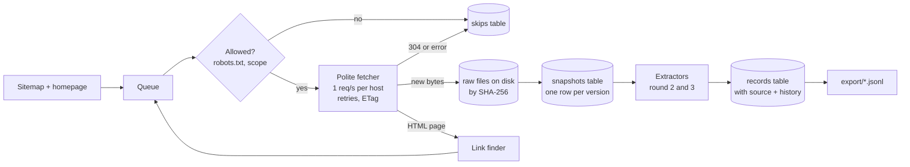
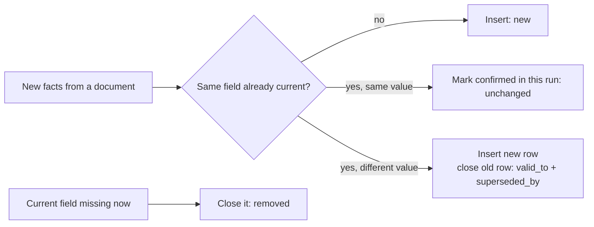
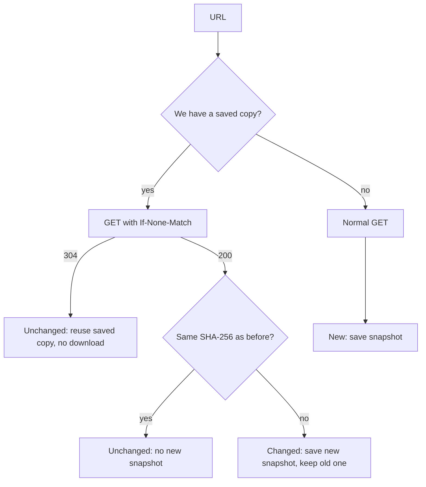

# scrapekit design

This document explains how scrapekit works, in plain terms. It is updated after every build round.

scrapekit is a general tool for turning public websites and their linked files into sourced, versioned data. The first source is CreateTO (createto.ca). Adding another website means adding one small config file, not changing the crawler (see section 4).

## 1. The goal in one paragraph

Visit every public page on createto.ca, download every file those pages link to (even when the file lives on another website), keep a copy of everything, and turn it into clean records such as "Project X is at 300 Commissioners Street, phase: leasing". Every record says where it came from. When we run it again later, it should only do work for things that changed, so a repeat run is fast and costs almost nothing.

## 2. What we learned about the site before building

| Finding | What it means for the design |
|---|---|
| `robots.txt` allows everything and lists a sitemap | We start from the sitemap (232 URLs) plus the homepage, then follow links to catch anything the sitemap misses. |
| Built with Next.js on Vercel, pages are rendered on the server | Plain HTTP is enough. No browser automation (Playwright) needed. |
| The server sends `ETag` headers | On a repeat run we ask "has this changed since ETag X?" and the server can answer `304 Not Modified` with no body. |
| Every sitemap `lastmod` is the same build timestamp | We cannot trust `lastmod` to detect changes. We use content hashes instead. |
| Project pages embed structured JSON (`address`, `phase`, `ward`) | Many useful fields can be read directly, for free, with no AI. |
| Most PDFs live on `a-us.storyblok.com`, others on `toronto.ca` | Files on other hosts are allowed. We fetch the file, but we do not crawl those other sites. |
| `/system/debug` is listed in the sitemap | Some public URLs are not useful. We skip them on purpose and log why. |

## 3. Big picture



## 4. The pieces (one job each)

### Sources: one file per website

Everything that is specific to a website lives in a `Source` object in `src/scrapekit/sources/`. The crawler only reads it.

```python
CREATETO = Source(
    name="createto",
    start_urls=("https://createto.ca/",),
    crawl_hosts=("createto.ca", "www.createto.ca"),
    sitemap_urls=("https://createto.ca/sitemap.xml",),
    excluded_path_prefixes=("/system/", "/search"),
)
```

To add a new website:
1. Create `sources/<name>.py` with a `Source`.
2. Add it to the list in `sources/__init__.py`.
3. Run `uv run scrapekit crawl <name>`.

A test (`test_a_new_source_needs_only_a_config`) proves this: it crawls a made-up second website with no crawler changes. In round 2, a Source can also point to its own extractor for site-specific fields, with a generic extractor as the fallback.

### Code modules

| File | Job |
|---|---|
| `sources/` | One `Source` per website (above). |
| `config.py` | Runtime settings shared by all sources (rate limit, size cap, user agent, folders). |
| `fetcher.py` | Downloads one URL politely. Waits 1 second between requests to the same host, retries on 429 and 5xx with backoff, honors `Retry-After`, sends `If-None-Match` / `If-Modified-Since`, refuses files over 50 MB. |
| `links.py` | Finds links in a page (including file links hidden inside Next.js JSON) and decides: crawl it, download it, or skip it. |
| `crawler.py` | The loop. Reads robots.txt per host, reads the sitemap, runs a small pool of workers over a queue, saves results, logs every skip. |
| `blobs.py` | Saves raw bytes to `data/raw/ab/abcdef....pdf`, named by SHA-256, so identical content is stored once. |
| `db.py` | SQLite tables (below). The crawler never writes SQL directly. |
| `metrics.py` | Counts everything in a run and writes `runs/<run_id>.md` and `.json`. |
| `cli.py` | `uv run scrapekit crawl <source>` and `uv run scrapekit sources` |

## 5. Extraction: from saved copies to facts

Extraction is a separate stage that only reads saved copies, never the website. So it can be re-run any time (for example after improving an extractor) with zero requests to the site.

### What a "fact" is

One field of one thing, plus where it came from:

| entity_type | entity_key | field | value | source_url | locator |
|---|---|---|---|---|---|
| project | south-river | phase | "Leasing" | https://createto.ca/projects/south-river | `__NEXT_DATA__ page.content.phase` |
| project | south-river | site_area | "18.5 acres" | same | `__NEXT_DATA__ page.content.siteArea` |
| document | https://a-us.storyblok.com/.../agenda.pdf | page_count | 12 | same | pdf structure |

Storing one row per field (instead of one wide row per project) makes history simple: each field can change on its own, and each one keeps its own source.

### Extractors

| Extractor | Used for | How |
|---|---|---|
| `storyblok` | createto.ca project and news pages | Reads the CMS record embedded in the page (`__NEXT_DATA__` JSON). Exact values, free, no AI. Named after the technology, so other Storyblok sites can reuse it. |
| `generic` | Any HTML page, and static pages on createto.ca | Title, meta description, headings, main text. Works on any site. |
| `pdf` | Every linked PDF | Text of each page (saved with 1-based page numbers for citing), page count, PDF metadata dates, first page excerpt. Scanned PDFs with no text are logged as `no_text_layer`. |

A source picks its page extractor in its config (`page_extractor="storyblok"`). The fallback is `generic`.

### Fields we keep and why

| Entity | Fields | Why they are useful later |
|---|---|---|
| project | name, phase, timeline (phase + schedule), ward, councillor, address, major intersection, location (lat/lon), site area, current / proposed / surrounding use, types, initiatives, summary, body text, published and CMS updated dates | Answers "what is CreateTO doing, where, and at what stage", and lets you track phase changes over time |
| news | title, published date, topics (e.g. board meetings), related projects, event dates, external link, body text | Board and committee meetings and announcements are where decisions show up first; dates let consumers filter to the last 5 years |
| document | title (from file name and PDF metadata), page count, created / modified dates, first page excerpt, page text | Agendas, minutes and reports are the deepest source; page text enables cited facts in round 3 |
| page | title, description, headings, text | Context pages (about, policies, strategic plan) |

### History: corrections and amendments



Nothing is overwritten. For any field you can see every value it ever had, when we first saw it, when it stopped being true, and which snapshot it came from. Example: a project moving from "Leasing" to "Completed" leaves two rows, linked.

### Re-runs stay cheap

The `extractions` table remembers (url, content hash, extractor version). If a document's content did not change, its extraction is skipped. If an extractor is improved, its version number is bumped and everything is re-extracted once from the saved copies.

## 6. Data model

```mermaid
erDiagram
    runs ||--o{ snapshots : "created in"
    runs ||--o{ skips : "logged in"
    snapshots ||--o{ facts : "read from"
    snapshots ||--o| pdf_pages : "text of"
    documents ||--o{ snapshots : "has versions"
    documents ||--o{ links : "links to"

    runs { text run_id PK; text source; text started_at; text finished_at; text stats_json }
    documents { text url PK; text source; text kind; text host; text etag; text current_hash; int last_status }
    snapshots { int id PK; text url; text content_hash; text fetched_at; text run_id; text path }
    skips { int id PK; text run_id; text url; text reason; text detail }
    links { text src; text dst }
    facts { int id PK; text entity_type; text entity_key; text field; text value; text source_url; text content_hash; text locator; text valid_from; text valid_to; int superseded_by }
    pdf_pages { text content_hash; int page_number; text text }
```

- **documents**: one row per URL we know (page or file), tagged with its source, with the latest status, ETag and hash.
- **snapshots**: one row per *distinct version* of a URL. Same content again does not add a row. A new row means the source changed, and the old version is still on disk. This is our history of the raw source.
- **skips**: every link we did not use, with a reason: `off_domain`, `excluded_path`, `robots_disallowed`, `http_404`, `network_error`, `too_large`, `non_http_link`, `max_pages`.
- **links**: which page linked to which URL, so every file can be traced back to the page that mentioned it.
- **facts**: one row per field of one entity, with source, locator and validity dates (section 5).
- **extractions**: which document versions were already extracted, and any failures.
- **pdf_pages**: text of each PDF page, keyed by content hash and page number.
- **runs**: one row per run with all the metrics.

## 7. What happens on a repeat run



"Unchanged" means no new snapshot, so the extraction step (and any paid AI call) is skipped for it.

## 8. Being polite (not DDoS-ing the site)

- At most 1 request per second **per host**, no matter how many workers run.
- A clear `User-Agent` that says what we are.
- robots.txt is read for every host before fetching from it.
- Retries back off (1s, 2s, 4s) and respect `Retry-After`.
- Conditional GETs mean a repeat run downloads almost nothing.

## 9. Decisions and trade-offs

| Decision | Why | What we gave up |
|---|---|---|
| Website details in a `Source` config, not in code | Adding a site is cheap and safe, the crawler is tested once | Very unusual sites may need a custom hook (planned: per-source extractor) |
| Plain async Python (`httpx`) instead of Scrapy | Small, easy to read and explain, enough for ~250 pages | Scrapy's built-in middleware ecosystem |
| No headless browser | Pages are server-rendered | Would need Playwright if the site moved to client-side rendering |
| SQLite + files on disk | Zero setup, one file to hand over, easy to query | Not built for many writers at once (Postgres would be the next step) |
| One row per fact, not one wide row per project | Each field keeps its own source and history; works for any entity type and any site | Consumers need a pivot to get one row per project (the export in round 4 does this) |
| Rules first, AI only for PDFs | Exact, free and testable where the data is structured | Free text inside pages is not mined for facts yet |
| Hash raw bytes for change detection | Exact and simple | Next.js pages may change bytes on every deploy without real content changes. Fact-level comparison handles this: a cosmetic change re-runs the cheap parser, but no fact changes and no AI call is made. |

## 10. Build rounds

| Round | Scope | Status |
|---|---|---|
| 1 | Polite crawler, sitemap + link walk, raw copies, skip log, run metrics, pluggable sources | Done |
| 2 | Extract fields from HTML (Next.js JSON) and text + page numbers from PDFs, fact history | Done |
| 3 | OpenRouter extraction for PDFs only, cached by hash, real cost tracking | Next |
| 4 | Record history (corrections), replay mode for the 3 variants, JSONL export | |
| 5 | Two real runs, results table, README polish | |
