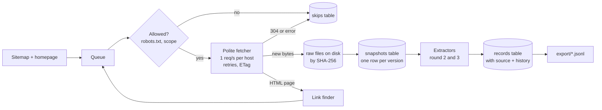
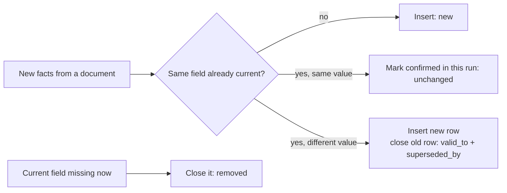
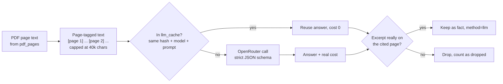
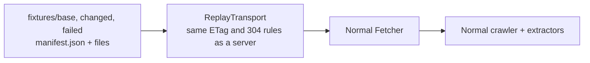
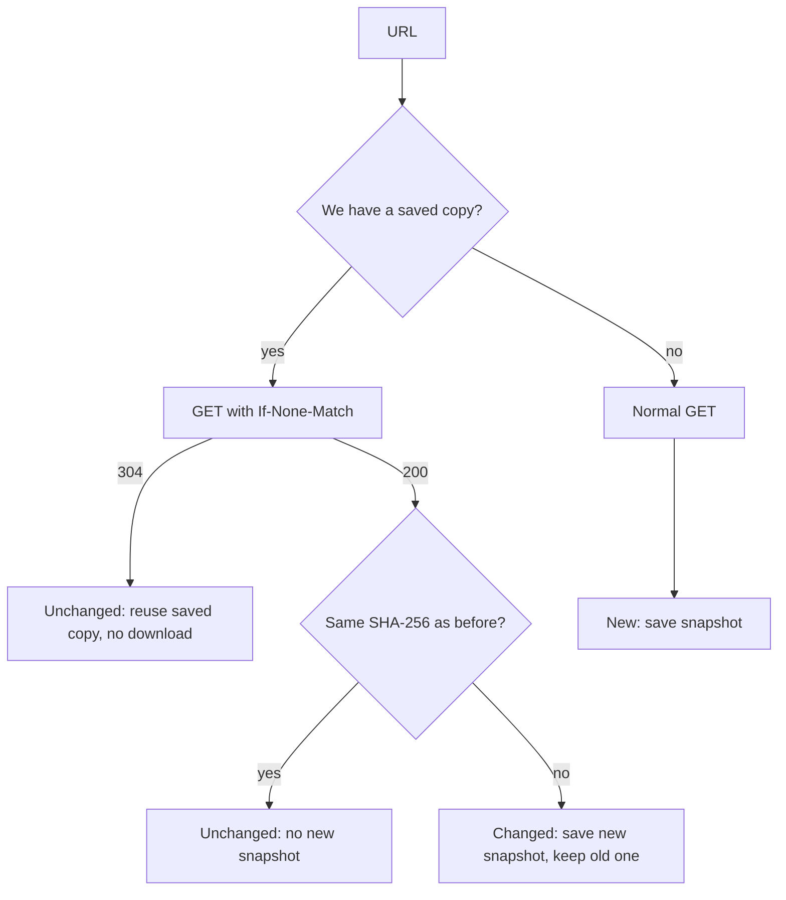

# scrapekit design

This document explains how scrapekit works, in plain terms. It is updated after every build round.

scrapekit is a general tool for turning public websites and their linked files into sourced, versioned data. The first source is CreateTO (createto.ca). Adding another website means adding one small config file, not changing the crawler (see section 5).

## 1. The goal in one paragraph

Visit every public page on createto.ca, download every file those pages link to (even when the file lives on another website), keep a copy of everything, and turn it into clean records such as "Project X is at 300 Commissioners Street, phase: leasing". Every record says where it came from. When we run it again later, it should only do work for things that changed, so a repeat run is fast and costs almost nothing.

## 2. What we learned about the site before building

| Finding | What it means for the design |
|---|---|
| `robots.txt` allows everything and lists a sitemap | We start from the sitemap (232 URLs) plus the homepage, then follow links to catch anything the sitemap misses. |
| Built with Next.js on Vercel, pages are rendered on the server | Plain HTTP is enough. No browser automation (Playwright) needed. |
| The server sends `ETag` headers | On a repeat run we ask "has this changed since ETag X?" and the server can answer `304 Not Modified` with no body. |
| Every sitemap `lastmod` is the same build timestamp | We cannot trust `lastmod` to detect changes. We use content hashes instead. |
| Project pages embed structured JSON (`address`, `phase`, `ward`) | Many useful fields can be read directly, for free, with no AI. |
| Most PDFs live on `a-us.storyblok.com`, others on `toronto.ca` | Files on other hosts are allowed. We fetch the file, but we do not crawl those other sites. |
| `/system/debug` is listed in the sitemap | Some public URLs are not useful. We skip them on purpose and log why. |

## 3. The stack, and why

| Tool | What it does here | Why we chose it | Alternatives we considered |
|---|---|---|---|
| **Python 3.11** | Everything | Best ecosystem for scraping, PDFs and LLM clients. Easy for any data engineer to read and extend. | Go or Rust would be faster, but speed is not the limit here (politeness is: 1 request per second per host). |
| **uv** | Installs dependencies, runs the CLI | One command setup (`uv sync`), a lock file so every machine gets the same versions, and very fast. | pip + venv (slower, no lock file by default), Poetry (heavier). |
| **httpx** (async) | All HTTP requests | Async, so files on other hosts download in parallel while each host still gets only 1 request per second. Supports streaming (to stop huge files early), redirects, timeouts, and has a built-in way to fake responses in tests (respx). | requests (no async), aiohttp (lower level, no easy test mocking). |
| **No Scrapy** | | For ~250 pages, a small asyncio crawler is easier to read, explain and test line by line. | Scrapy is the right call for many large sites; Part 2 could move to it or to a queue-based worker design. |
| **No headless browser** | | The site is rendered on the server (Next.js), so the HTML already contains the content and data. A browser would be about 10x slower and heavier. | Playwright, if a future source only renders in the browser. |
| **selectolax** (lexbor) | Parses HTML to find links and text | Very fast, small, and follows the modern HTML5 standard. | BeautifulSoup (simpler API but much slower), lxml. |
| **defusedxml** | Parses sitemaps | Safe against malicious XML (entity expansion attacks), since sitemaps come from outside. | The standard library XML parser, which is not hardened. |
| **PyMuPDF** | Reads PDF text page by page, and metadata | Fast, reliable text extraction with exact page numbers, which we need to cite facts. | pdfplumber (great for tables, slower), pypdf (weaker on messy PDFs). |
| **SQLite** | Stores documents, versions, facts, skips, runs | Zero setup, one file to hand to another service, real SQL for queries and checks. | Postgres is the next step when many workers write at once (Part 2). |
| **Files named by SHA-256** | Raw copies of pages and files | Identical content is stored once, and the hash doubles as the change detector. | Storing blobs in the database (makes it huge), naming by URL (breaks on changes). |
| **OpenRouter** (via the OpenAI SDK) | LLM calls for PDFs | One API key for many model providers, so we can switch to a cheaper or better model by changing one setting. It reports the real cost of each call, which we sum per run. | Calling one provider directly (locks us in, cost must be computed by hand). |
| **google/gemini-3.1-flash-lite** (default model) | Reads PDF text, returns structured facts | Cheap ($0.25 per million input tokens, $1.50 per million output), very long context, supports strict JSON schema output. Good enough for "find addresses, dates and decisions with a quote". | Larger models cost 3x to 10x more; worth testing on a small labeled sample before switching. Configurable with `--llm-model`. |
| **pytest + respx** | Tests | respx fakes the website, so tests run offline in under a second and never touch CreateTO. | Recording real responses (brittle, and repeatedly hits the real site). |

## 4. Big picture



## 5. The pieces (one job each)

### Sources: one file per website

Everything that is specific to a website lives in a `Source` object in `src/scrapekit/sources/`. The crawler only reads it.

```python
CREATETO = Source(
    name="createto",
    start_urls=("https://createto.ca/",),
    crawl_hosts=("createto.ca", "www.createto.ca"),
    sitemap_urls=("https://createto.ca/sitemap.xml",),
    excluded_path_prefixes=("/system/", "/search"),
)
```

To add a new website:
1. Create `sources/<name>.py` with a `Source`.
2. Add it to the list in `sources/__init__.py`.
3. Run `uv run scrapekit crawl <name>`.

A test (`test_a_new_source_needs_only_a_config`) proves this: it crawls a made-up second website with no crawler changes. In round 2, a Source can also point to its own extractor for site-specific fields, with a generic extractor as the fallback.

### Code modules

| File | Job |
|---|---|
| `sources/` | One `Source` per website (above). |
| `config.py` | Runtime settings shared by all sources (rate limit, size cap, user agent, folders). |
| `fetcher.py` | Downloads one URL politely. Waits 1 second between requests to the same host, retries on 429 and 5xx with backoff, honors `Retry-After`, sends `If-None-Match` / `If-Modified-Since`, refuses files over 50 MB. |
| `links.py` | Finds links in a page (including file links hidden inside Next.js JSON) and decides: crawl it, download it, or skip it. |
| `crawler.py` | The loop. Reads robots.txt per host, reads the sitemap, runs a small pool of workers over a queue, saves results, logs every skip. |
| `blobs.py` | Saves raw bytes to `data/raw/ab/abcdef....pdf`, named by SHA-256, so identical content is stored once. |
| `db.py` | SQLite tables (below). The crawler never writes SQL directly. |
| `metrics.py` | Counts everything in a run and writes `runs/<run_id>.md` and `.json`. |
| `extract/` | Rule-based extractors: `storyblok`, `generic_html`, `pdf`. |
| `extract_stage.py` | Runs pass 1 (rules) and pass 2 (LLM) over saved copies. |
| `llm.py` | OpenRouter client, prompt, JSON schema, excerpt check. |
| `export.py` | JSON Lines export for other services. |
| `replay.py` | Serves saved copies as if they were the website. |
| `variants.py` | Builds fixtures and runs the first / unchanged / changed / failed scenarios. |
| `cli.py` | `scrapekit run / crawl / extract / export / variants <source>` and `scrapekit sources` |

## 6. Extraction: from saved copies to facts

Extraction is a separate stage that only reads saved copies, never the website. So it can be re-run any time (for example after improving an extractor) with zero requests to the site.

### What a "fact" is

One field of one thing, plus where it came from:

| entity_type | entity_key | field | value | source_url | locator |
|---|---|---|---|---|---|
| project | south-river | phase | "Leasing" | https://createto.ca/projects/south-river | `__NEXT_DATA__ page.content.phase` |
| project | south-river | site_area | "18.5 acres" | same | `__NEXT_DATA__ page.content.siteArea` |
| document | https://a-us.storyblok.com/.../agenda.pdf | page_count | 12 | same | pdf structure |

Storing one row per field (instead of one wide row per project) makes history simple: each field can change on its own, and each one keeps its own source.

### Extractors

| Extractor | Used for | How |
|---|---|---|
| `storyblok` | createto.ca project and news pages | Reads the CMS record embedded in the page (`__NEXT_DATA__` JSON). Exact values, free, no AI. Named after the technology, so other Storyblok sites can reuse it. |
| `generic` | Any HTML page, and static pages on createto.ca | Title, meta description, headings, main text. Works on any site. |
| `pdf` (pass 1) | Every linked PDF | Text of each page (saved with 1-based page numbers for citing), page count, PDF metadata dates, first page excerpt. Scanned PDFs with no text are logged as `no_text_layer`. |

A source picks its page extractor in its config (`page_extractor="storyblok"`). The fallback is `generic`.

### Fields we keep and why

| Entity | Fields | Why they are useful later |
|---|---|---|
| project | name, phase, timeline (phase + schedule), ward, councillor, address, major intersection, location (lat/lon), site area, current / proposed / surrounding use, types, initiatives, summary, body text, published and CMS updated dates | Answers "what is CreateTO doing, where, and at what stage", and lets you track phase changes over time |
| news | title, published date, topics (e.g. board meetings), related projects, event dates, external link, body text | Board and committee meetings and announcements are where decisions show up first; dates let consumers filter to the last 5 years |
| document | title (from file name and PDF metadata), page count, created / modified dates, first page excerpt, page text | Agendas, minutes and reports are the deepest source; page text enables cited facts in round 3 |
| page | title, description, headings, text | Context pages (about, policies, strategic plan) |

### History: corrections and amendments



Nothing is overwritten. For any field you can see every value it ever had, when we first saw it, when it stopped being true, and which snapshot it came from. Example: a project moving from "Leasing" to "Completed" leaves two rows, linked.

### Re-runs stay cheap

The `extractions` table remembers (url, content hash, extractor version). If a document's content did not change, its extraction is skipped. If an extractor is improved, its version number is bumped and everything is re-extracted once from the saved copies.

### Pass 2: the LLM reads PDFs (paid, optional)

Rules cannot read meaning from a 40 page board report. For that, an LLM reads each PDF that has text and returns facts with citations.



**What we ask for** (strict JSON schema, so the answer is always machine readable):
- `doc_type` from a fixed list (board agenda, minutes, staff report, plan or study, brochure, ...)
- `title`, `document_date`, `organization`, a one or two sentence `summary`
- up to 15 `facts`, each with `kind` (address, project, decision, amount, date, phase, organization), `value`, `page`, and an exact `excerpt` of 5 to 25 words

**How we keep it honest and cheap:**

| Concern | What we do |
|---|---|
| Made-up facts | Every fact must quote the page. We check the quote is really there, ignoring case, spacing and punctuation. If not, the fact is dropped and counted in the run report. The check allows three real-world PDF quirks we found in testing: a sentence that runs over a page break, numbers split by the PDF text layer (`50 0,000`), and a page footer sitting inside the quoted sentence (the quote may be split once into two verbatim parts of 4+ words, at most 300 characters apart). Side effect, by design: a quote the model shortens with "..." is accepted only when both parts are verbatim on the page and at most 300 characters apart; if they are further apart or not verbatim, it is rejected. |
| Wrong page numbers | Same check: the quote must be on the cited page, and the page must exist. |
| Paying twice | Answers are cached by content hash + model + prompt version. An unchanged PDF is never sent again, even if it appears under a second URL. Changing the model or prompt re-runs only what is needed. Improving the excerpt check has its own version number and re-checks cached answers for free. `--llm-limit` counts only paid calls. |
| Huge documents | Text is capped at 40,000 characters (about 10,000 tokens). Long documents send their start (about 70%) and their end (about 30%) with `[pages X-Y omitted]` in between, because amendments, signatures and final decisions often sit at the end. We found this in the variant test: an amendment added as the last page was invisible when only the start was sent. The locator records exactly which pages the model saw, for example `llm over pages 1-15, 20-22 of 22`. |
| Slow runs | Up to 8 calls at once. |
| API errors or bad JSON | Retries (3), then the document is logged as `llm_error` and the run continues. Rule-based facts for it are still saved. |
| Real cost | OpenRouter returns the actual cost of every call. We add it up per run. |
| Runaway spend | Hard budget per run (default $0.50, `--llm-budget`). Once reached, no new calls start; the remaining PDFs are logged as `llm_budget_reached` and picked up next run. `--llm-dry-run` shows the number of PDFs and the estimated cost without calling anything. |
| Rule facts vs LLM facts | Stored with `method = parse` or `llm`, and compared separately, so one never overwrites the other. |

Run without the LLM: `uv run scrapekit run createto --no-llm`. Try it on a few files first: `--llm-limit 10`.

Dry-run estimate on the real crawl (466 PDFs with text): about 1.49M input tokens, estimated $0.93 for the whole first run with the default model.

Trial on 10 real PDFs: $0.0152 actual (estimate $0.02), 4.9 seconds, 0 failures. Doc types, dates, organizations, addresses and project names were correct on manual review.

## 6b. Export for other services

`uv run scrapekit export createto` writes JSON Lines files to `export/createto/`, so another service can load the data without SQLite:

| File | One line per | Use it for |
|---|---|---|
| `entities.jsonl` | project, news item, document or page, with current values only | Loading the latest state. Every field carries its value, locator, excerpt, method and the snapshot hash it came from. Pages list their linked documents; documents list the pages that link to them. |
| `facts.jsonl` | every value ever recorded, including superseded ones | History, audits, "what did the site say on date X" |
| `documents.jsonl` | URL | Crawl status, hashes, where each URL was found |
| `skips.jsonl` | skipped or failed link | Monitoring and coverage checks |
| `runs.jsonl` | run | Metrics over time |
| `SCHEMA.md` | | Field-by-field description |

## 6c. Replay mode and the three variants

The brief asks to show an unchanged run, a changed source and a failed file. Waiting for the live site to change is not repeatable, so scrapekit can **replay saved local copies** through the normal crawler.



- `ReplayTransport` plugs into the same HTTP client, so the code under test is exactly the code that runs live. It serves ETags and answers `304 Not Modified`, like a real server.
- A replay run limits the source to the fixture URLs with `url_allowlist` (other links are logged as `not_in_allowlist`). The same allowlist is the natural hook for backfilling a chosen list of pages.
- `uv run scrapekit variants createto` takes a small real slice of the crawl (homepage, project and news pages, and their smallest PDFs), builds three fixture sets, and runs four scenarios into a fresh database:

| Run | Fixture | What it shows |
|---|---|---|
| 1. first run | base | Everything new, LLM pays for each PDF |
| 2. unchanged repeat | base | All 304, nothing re-extracted, 0 paid calls |
| 3. changed source | changed | A project's phase edited, a PDF amended with an extra page: only those two are re-processed, old values kept as history, 1 paid call |
| 4. failed file | failed | One PDF corrupt, one returns 404: both logged, the run continues |

The result is written to `examples/variants/REPORT.md`. Reviewers can re-run it from the committed fixtures with no crawl: `uv run scrapekit variants createto --reuse-fixtures` (add `--no-llm` to skip the few cents of LLM cost).

## 7. Data model

```mermaid
erDiagram
    runs ||--o{ snapshots : "created in"
    runs ||--o{ skips : "logged in"
    snapshots ||--o{ facts : "read from"
    snapshots ||--o| pdf_pages : "text of"
    documents ||--o{ snapshots : "has versions"
    documents ||--o{ links : "links to"

    runs { text run_id PK; text source; text started_at; text finished_at; text stats_json }
    documents { text url PK; text source; text kind; text host; text etag; text current_hash; int last_status }
    snapshots { int id PK; text url; text content_hash; text fetched_at; text run_id; text path }
    skips { int id PK; text run_id; text url; text reason; text detail }
    links { text src; text dst }
    facts { int id PK; text entity_type; text entity_key; text field; text value; text source_url; text content_hash; text locator; text valid_from; text valid_to; int superseded_by }
    pdf_pages { text content_hash; int page_number; text text }
    llm_cache { text content_hash; text model_key; text response; real cost_usd }
```

- **documents**: one row per URL we know (page or file), tagged with its source, with the latest status, ETag and hash.
- **snapshots**: one row per *distinct version* of a URL. Same content again does not add a row. A new row means the source changed, and the old version is still on disk. This is our history of the raw source.
- **skips**: every link we did not use, with a reason: `off_domain`, `excluded_path`, `robots_disallowed`, `http_404`, `network_error`, `too_large`, `non_http_link`, `max_pages`.
- **links**: which page linked to which URL, so every file can be traced back to the page that mentioned it.
- **facts**: one row per field of one entity, with source, locator and validity dates (section 6).
- **extractions**: which document versions were already extracted, and any failures.
- **pdf_pages**: text of each PDF page, keyed by content hash and page number.
- **llm_cache**: every paid LLM answer, keyed by content hash and model + prompt version, with tokens and cost.
- **runs**: one row per run with all the metrics.

## 8. What happens on a repeat run



"Unchanged" means no new snapshot, so the extraction step (and any paid AI call) is skipped for it.

## 9. Being polite (not DDoS-ing the site)

- At most 1 request per second **per host**, no matter how many workers run.
- A clear `User-Agent` that says what we are.
- robots.txt is read for every host before fetching from it.
- Retries back off (1s, 2s, 4s) and respect `Retry-After`.
- Conditional GETs mean a repeat run downloads almost nothing.

## 10. Decisions and trade-offs

| Decision | Why | What we gave up |
|---|---|---|
| Website details in a `Source` config, not in code | Adding a site is cheap and safe, the crawler is tested once | Very unusual sites may need a custom hook (planned: per-source extractor) |
| Plain async Python (`httpx`) instead of Scrapy | Small, easy to read and explain, enough for ~250 pages | Scrapy's built-in middleware ecosystem |
| No headless browser | Pages are server-rendered | Would need Playwright if the site moved to client-side rendering |
| SQLite + files on disk | Zero setup, one file to hand over, easy to query | Not built for many writers at once (Postgres would be the next step) |
| One row per fact, not one wide row per project | Each field keeps its own source and history; works for any entity type and any site | Consumers need a pivot to get one row per project (the export in round 4 does this) |
| Rules first, AI only for PDFs | Exact, free and testable where the data is structured | Free text inside pages is not mined for facts yet |
| Hash raw bytes for change detection | Exact and simple | Next.js pages may change bytes on every deploy without real content changes. Fact-level comparison handles this: a cosmetic change re-runs the cheap parser, but no fact changes and no AI call is made. |
| Do not re-check files with immutable URLs (Storyblok gives every upload a new URL) | Repeat runs skip about 470 requests, so they are several times faster and lighter on the hosts | A file deleted or corrupted in place would not be noticed until a full re-check. Mitigation: schedule `--revalidate-all` periodically (for example weekly). The variant demo uses it so file failures are visible. |

## 11. Build rounds

| Round | Scope | Status |
|---|---|---|
| 1 | Polite crawler, sitemap + link walk, raw copies, skip log, run metrics, pluggable sources | Done |
| 2 | Extract fields from HTML (Next.js JSON) and text + page numbers from PDFs, fact history | Done |
| 3 | OpenRouter extraction for PDFs only, cached by hash, real cost tracking, budget cap | Done |
| 4 | Replay mode and the 3 variants, JSONL export, faster repeat runs (immutable file URLs) | Done |
| 5 | Two real runs, results table, labeled costs, example output, 5 year flag in export | Done |
